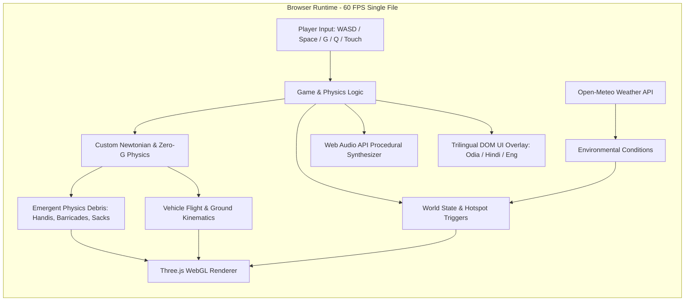

# Product Requirements Document (PRD)
## BHUBANESWAR 3D: AMA GADI, AMA RASTA
### (Benglooru × FightKaro × Delhi Metro × Antigravity & Emergent Physics Edition)
**A 3D Hyper-Local Open-World Driving, Antigravity Levitation, Street Satire & Emergent Physics Sandbox**

---

## 1. Executive Summary & Vision

- **Product Name:** *Bhubaneswar 3D: Ama Gadi, Ama Rasta (Antigravity & Emergent Mechanics Edition)*
- **Live Deployment:** [https://forbesayush.github.io/odisha-simulator/](https://forbesayush.github.io/odisha-simulator/)
- **Source Repository:** [github.com/forbesayush/odisha-simulator](https://github.com/forbesayush/odisha-simulator)
- **Target Audience:** Casual web gamers, mobile and desktop commuters, fans of Indian urban culture, retro arcade enthusiasts.
- **Core Vision:** Merge the localized urban satire of **Benglooru.com**, the visceral 1v1 arcade combat of **FightKaro.com**, the obstacle agility of **DelhiMetroGame.com**, and the 3D vehicular open-world freedom of **GTA** with cutting-edge **Antigravity Mechanics** (zero-G flight, gravity inversion, repulsor thrusters) and **Emergent Physics Gameplay** (cascading chain reactions, ricocheting debris, floating Dahibara handis, movable street barriers).

---

## 2. Core Inspirations & Architectural Pillars

```
+---------------------------------------------------------------------------------------------------------+
|                                      BHUBANESWAR 3D CORE PILLARS                                        |
+---------------------------------------------------------------------------------------------------------+
| 1. BENGLOORU.COM SATIRE  | 2. FIGHTKARO.COM COMBAT   | 3. OPEN-WORLD FREEDOM  | 4. ANTIGRAVITY EMERGENCE|
| Odia cultural humor,     | 1v1 street brawls with   | Drive White Activa or  | Zero-G thrusters, gravity|
| trilingual dialogue      | side-view dynamic arena  | 1998 Pink Vikram Auto  | flips, levitating debris|
| trees, Pakhala stamina & | camera, HP gauges, and   | across Janpath & NH-16 | & cascading physics     |
| live weather sensors.    | Odia super moves.        | with cows & Mo Buses.  | sandbox chain reactions.|
+---------------------------------------------------------------------------------------------------------+
```

### 1. Antigravity Mechanics (ଶୂନ୍ୟ ମାଧ୍ୟାକର୍ଷଣ)
- **Zero-G Physics:** Neutralizes or reverses vertical gravitational acceleration on demand (`[G]` key or UI toggle).
- **Vehicular Levitation:** Vehicles (Activa 6G / Pink Vikram Auto) sprout glowing cyan/magenta plasma repulsor fields beneath their chassis.
- **3D Thruster Controls:** Smooth vertical flight (`Space` for lift thrust, `Shift` / `C` for descent thrust), 3D pitch/roll tilts, and rooftop landing.
- **Repulsor Shockwave Pulse (`[Q]` / `[B]`):** Emits an omnidirectional electromagnetic shockwave, repelling and lifting nearby physics objects into zero-G orbit.

### 2. Emergent Gameplay & Physics Sandbox (ଭୌତିକ ବିଜ୍ଞାନ ଜୁଗାଡ଼)
- **Complex Outcomes from Simple Rules:** Movable objects in the world (aluminum Dahibara handis, 50kg potato sacks, yellow police barricades, Tookna paan boxes, tin roofs, and cows) possess mass, velocity, angular momentum, and restitution.
- **Cascading Chain Reactions:** Ramming an object or blasting it with an Antigravity Pulse launches it into adjacent objects, cars, or bystanders, setting off hilarious multi-body chain reactions.
- **Zero-G Environmental Interactions:** In Antigravity mode, debris floats weightlessly, forming dynamic floating asteroid-like obstacle fields over Janpath.

### 3. FightKaro.com 3D Street Brawls
- Instant transition into side-view 1v1 fighting games when encountering iconic Bhubaneswar characters (Bidyadhar Mausa, Tookna Bhai, Ramesh Broker, Pink Auto Union Chief).
- Moves include: *Guguni Splash*, *Tookna Chuna Slap*, *Pahala Rasagola Slam*, and *Vani Vihar Squad*.
- Zero-G brawl modification: mid-air levitating combat with comic knockback bursts (`ଦିଶୁମ୍! / DISHUUM!`).

### 4. Benglooru.com & Delhi Metro Elements
- Survival attributes: `ପଖାଳ STAMINA`, `JUGAAD (ଭାଇଚାରା)`, `KARMA (ଶାନ୍ତି)`, `WALLET (ଟଙ୍କା)`.
- Live Open-Meteo API Bhubaneswar weather tracking with manual cyclonic Kalabaisakhi storm toggle (3D rain particles, pitch darkness, wind gusts).
- High-speed highway transit dodging moving green Mo Buses and sacred cows.

---

## 3. High-Level Technical Architecture



---

## 4. Physics Engine & Antigravity Mathematical Model

### 1. Translational Motion
In normal gravity mode:
$$\vec{a} = \frac{\vec{F}_{\text{drive}} + \vec{F}_{\text{friction}}}{m} + \vec{g}$$
where $\vec{g} = (0, -9.81, 0)\text{ m/s}^2$.

In Antigravity Mode (`isAntigrav = true`):
$$\vec{g}_{\text{eff}} = (0, 0, 0)\text{ m/s}^2$$
Vertical thrust force:
$$\vec{F}_{\text{thrust}} = (0, T_{\text{up}} - T_{\text{down}}, 0)$$
Vehicle altitude is smoothly clamped between $0.2\text{m}$ (ground hover) and $45\text{m}$ (cloud boundary).

### 2. Antigravity Repulsor Pulse (Shockwave)
Upon triggering pulse at origin $\vec{P}_{\text{player}}$:
$$\vec{F}_{\text{repulse}}(i) = \frac{K_{\text{pulse}}}{|\vec{P}_i - \vec{P}_{\text{player}}|^2 + \epsilon} \cdot \hat{r}_i + \vec{J}_{\text{lift}}$$
where $\vec{J}_{\text{lift}}$ provides an immediate upward vertical impulse, sending debris tumbling into zero-G suspension.

### 3. Emergent Collision & Restitution
For colliding bodies $A$ and $B$:
$$\vec{v}_A' = \vec{v}_A - \frac{(1 + e) m_B}{m_A + m_B} \frac{(\vec{v}_A - \vec{v}_B) \cdot (\vec{x}_A - \vec{x}_B)}{|\vec{x}_A - \vec{x}_B|^2} (\vec{x}_A - \vec{x}_B)$$
Angular tumble:
$$\vec{\omega}' = \vec{\omega} + \frac{\vec{r} \times \Delta \vec{p}}{I}$$
Objects spin continuously while in zero-G until settled by atmospheric damping.

---

## 5. Control Mappings (Desktop & Mobile Touch)

| Action | Desktop Key | Mobile Touch Control | Description |
| :--- | :--- | :--- | :--- |
| **Drive / Pitch Down** | `W` / `↑` | **▲ UP** Button | Accelerates forward / tilts nose forward |
| **Brake / Reverse** | `S` / `↓` | **▼ DOWN** Button | Brakes, reverses, or slows flight |
| **Steer Left** | `A` / `←` | **◀ LEFT** Button | Steers left / zero-G yaw left |
| **Steer Right** | `D` / `→` | **▶ RIGHT** Button | Steers right / zero-G yaw right |
| **Antigravity Lift** | `Space` | **🚀 LIFT** Button | Fires vertical repulsor thrusters to float |
| **Antigravity Descent**| `Shift` / `C`| **🛬 DIVE** Button | Descends toward road or rooftop |
| **Toggle Antigrav** | `G` | **🛸 ANTIGRAV** Pill | Inverts/neutralizes gravity for vehicle & city |
| **Repulsor Pulse** | `Q` / `B` | **⚡ PULSE** Button | Emits zero-G shockwave launching physics debris |
| **Vehicle Swap** | `V` | **🔄 SWAP** Pill | Activa 6G $\leftrightarrow$ 1998 Pink Vikram Auto |
| **Sound Horn** | `H` | **📢 HORN** Button | Plays localized horn & triggers comedic reactions |
| **Interact / Fight**| `E` / `Enter`| **💥 ACTION** Button | Opens landmark dialogue or initiates 3D brawl |
| **Language Switch** | `L` | **🌐 🌐** Button | Cycles Odia (`ଓଡ଼ିଆ`), Hindi (`हिंदी`), English |

---

## 6. Procedural Asset & Emergent World Matrix

| Asset Name | Geometry Representation | Physics Attributes | Emergent Interaction |
| :--- | :--- | :--- | :--- |
| **Dahibara Handi** | Cylinder + Torus rim | $m = 12\text{kg}$, high bounce | Hits release white Dahi-Pani splashes, ricochets into autos |
| **50kg Potato Sack (ବସ୍ତା)**| Rounded Box | $m = 50\text{kg}$, low bounce | Heavy barrier; rolls into traffic causing buses to brake |
| **Police Barricades** | Slender Box + Legs | $m = 25\text{kg}$, high friction | Flips and spins when rammed, wedges under vehicle wheels |
| **Tookna Paan Stalls** | Compound Box + Canvas | $m = 35\text{kg}$, breakable | Explodes into flying paan leaves and supari boxes upon impact |
| **Coconut Daba Heaps** | Multisphere clusters | $m = 5\text{kg}$, elastic sphere | Scatters in all directions like billiard balls |
| **Flying Tin Roofs** | Thin flat Quad | $m = 8\text{kg}$, aerodynamic lift | Glides through air during Kalabaisakhi or zero-G vortex |
| **Sacred Street Cow** | Boxy Bovine Mesh | $m = 400\text{kg}$, immovable ground | Immune to player horns; in zero-G floats placidly mooing |

---

## 7. Trilingual Localization Matrix (Odia / Hindi / English)

| Key / Context | Odia (`ଓଡ଼ିଆ`) | Hindi (`हिंदी`) | English |
| :--- | :--- | :--- | :--- |
| **Title** | ଭୁବନେଶ୍ୱର 3D: ଆମ ଗାଡ଼ି ଆମ ରାସ୍ତା | भुवनेश्वर 3D: हमारी गाड़ी, हमारा रास्ता | Bhubaneswar 3D: Our Ride, Our Road |
| **Antigravity Active**| ଶୂନ୍ୟ ମାଧ୍ୟାକର୍ଷଣ ସକ୍ରିୟ (ଉଡ଼ନ୍ତା ଗାଡ଼ି) | एंटी-ग्रेविटी मोड सक्रिय (उड़ती गाड़ी) | ANTIGRAV ACTIVE: ZERO-G FLIGHT |
| **Repulsor Pulse** | ବିକର୍ଷଣ ତରଙ୍ଗ ବିସ୍ଫୋରଣ! | विकर्षण तरंग का झटका! | REPULSOR SHOCKWAVE PULSE! |
| **Pakhala Stamina** | ପଖାଳ ଷ୍ଟାମିନା | पखाल स्टेमिना | Pakhala Stamina |
| **Jugaad Level** | ଭାଇଚାରା ଜୁଗାଡ଼ | भाईचारा जुगाड़ | Street Jugaad |
| **Dahibara Quote** | "ପାଣି ଟିକେ ମାରିବି କି ବାବୁ?" | "भैया थोड़ा और दही पानी डालूँ?" | "Should I splash some more Dahi-Pani?" |
| **Tookna Quote** | "ଏଠି କଣ ହଉଚି ବେ? ଚୂନ ଟିକେ ଖାଇବୁ?" | "यहाँ क्या हो रहा है बे? चूना खाओगे?" | "What's up bro? Want some lime-paste slap?" |
| **Auto Boss Quote** | "ମିଟର ଫିଟର ନାଇଁ! ଡାଇରେକ୍ଟ ₹୧୫୦!" | "मीटर-वीटर नहीं! सीधा ₹१५०!" | "No meter! Straight ₹150 flat!" |

---

## 8. Web Audio API Procedural Synthesizer Architecture

All audio in the game is synthesized at runtime without loading external `.mp3` or `.wav` files:
1. **Antigravity Repulsor Hum:** Continuous dual oscillator (`sine` at $55\text{Hz}$ modulated by `triangle` at $110\text{Hz}$) routed through a resonant low-pass filter with frequency scaling based on vehicle altitude.
2. **Thruster Jet Blast:** White noise buffer filtered with high-pass and band-pass sweeps during `Space` / `Shift` thruster engagement.
3. **Electromagnetic Pulse (Shockwave):** Exponential frequency ramp from $800\text{Hz}$ down to $40\text{Hz}$ with distortion waveshaping.
4. **Dahibara Aluminum Ladle Clang:** High resonant bell synthesis ($930\text{Hz}$, $970\text{Hz}$, $530\text{Hz}$).
5. **Tookna Chuna Slap:** Triple noise burst simulating palm-on-thigh limestone rubbing.
6. **Vehicle Horns:** Dual harmonic sawtooth ($360\text{Hz}$ for Vikram Auto) and square wave ($520\text{Hz}$ for Activa).

---

## 9. Performance & Mobile Optimization Targets

- **Frame Rate Target:** Rock-solid 60 FPS on both mobile browsers (iOS Safari, Android Chrome) and desktop.
- **Bundle Footprint:** $< 150\text{ KB}$ initial HTML delivery (Three.js and fonts loaded via CDN with instant cache).
- **Physics Spatial Culling:** Debris physics updates restricted to active 150-unit sphere around player.
- **Instant Zero-Build Execution:** Zero npm/Node build steps, direct GitHub Pages execution from `index.html`.
