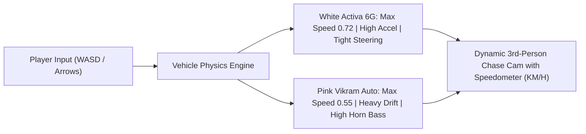

# Product Requirements Document (PRD)
## BHUBANESWAR 3D: AMA GADI, AMA RASTA
### (Benglooru × FightKaro × Delhi Metro Edition)
**A 3D Hyper-Local Open-World Driving, Street Satire & 1v1 Street Brawl Game**

---

## 1. Executive Summary & Project Overview

- **Product Name:** *Bhubaneswar 3D: Ama Gadi, Ama Rasta (Benglooru × FightKaro Edition)*
- **Live Deployment:** [https://forbesayush.github.io/odisha-simulator/](https://forbesayush.github.io/odisha-simulator/)
- **Repository:** [github.com/forbesayush/odisha-simulator](https://github.com/forbesayush/odisha-simulator)
- **Target Audience:** Casual web gamers, commuters, fans of Indian urban culture, retro arcade enthusiasts.
- **Tech Stack:**
  - **Renderer:** Pure client-side Three.js (WebGL, r128 CDN)
  - **Typography:** Google Fonts (`Press Start 2P`, `VT323`, `Noto Sans Oriya`)
  - **Audio Engine:** HTML5 Web Audio API (100% procedural waveform synthesis — 0 external audio downloads)
  - **Live Weather API:** Open-Meteo REST API (Bhubaneswar: 20.2961° N, 85.8245° E)
  - **Hosting:** GitHub Pages via GitHub Actions Jekyll/Static pipeline

---

## 2. Core Inspirations & Product Pillars

```
+-----------------------------------------------------------------------------------------+
|                              BHUBANESWAR 3D CORE PILLARS                                |
+-----------------------------------------------------------------------------------------+
|  1. BENGLOORU.COM SATIRE    |  2. FIGHTKARO.COM COMBAT     |  3. OPEN-WORLD 3D FREEDOM  |
|  Hyper-local Odia humor,    |  1v1 street brawling with    |  Drive Activa or Pink      |
|  trilingual street quotes,  |  dynamic side-arena camera,  |  Vikram Auto across        |
|  pakhala/jugaad stats, and  |  HP gauges, and Odia combat  |  Janpath & NH-16 with live |
|  real-time city weather.    |  moves (Guguni Splash!).     |  cows & moving Mo Buses.   |
+-----------------------------------------------------------------------------------------+
```

1. **Benglooru.com-Style Urban Satire & Micro-Interactions:**
   - Survival stats reflecting authentic Odia street life: `ପଖାଳ STAMINA`, `JUGAAD (ଭାଇଚାରା)`, `KARMA (ଶାନ୍ତି)`, `WALLET (ଟଙ୍କା)`.
   - Trilingual dialogue trees mixing Odia, Hindi, and English with razor-sharp localized comedic timing.
   - Real-time weather fetched directly from Bhubaneswar atmospheric sensors + manual toggle for the cyclonic Kalabaisakhi thunderstorm.
2. **FightKaro.com 3D Combat Arena:**
   - Any confrontation can escalate into a full 3D street brawl.
   - Dynamic arena camera transition smoothly framing the player and NPC in a classic side-view fighting perspective.
   - Visual 3D knockback animations on the boss mesh when hit.
3. **Open-World 3D Street Freedom (GTA / Delhi Metro Elements):**
   - Free 3D driving physics across Janpath and NH-16 highway intersections.
   - Instant vehicle swapping between the nimble **White Activa 6G** and the heavy **1998 Pink Vikram Auto**.
   - Moving green Mo Buses, road dividers, and sacred street cows that ignore player horns.

---

## 3. Detailed Feature Specifications

### 3.1 3D Open-World Map & Landmark Hotspots
The 3D map features an expansive 500x500 ground with laterite soil and intersecting asphalt highways, housing 4 iconic interactive zones marked by animated glowing ground rings:

| Landmark Zone | Coordinates | 3D Landmark Props | NPC Boss | Theme & Dialogue Conflict |
| :--- | :--- | :--- | :--- | :--- |
| **1. Saheed Nagar Dahibara Cart** | `X: 22, Z: -28` | Wooden cart, giant aluminum Handi wrapped in damp crimson cotton | **Bidyadhar Mausa** | A tech bro asked for Tomato Ketchup & Sweet Corn on sacred Cuttack Dahibara Aloodum! |
| **2. Omfed Tookna Pan Dukan** | `X: -21, Z: -35` | Green Omfed booth, hanging Safa/Barkha strips, red stools | **Tookna Bhai** | ₹10 tea paid with ₹20 note. Tookna slides 5 sticky Melody chocolates instead of loose cash. |
| **3. Patia Bachelor To-Let Scam** | `X: -42, Z: 28` | Neon-green G+2 house, rusted iron gate, "No Bachelors" sign | **Ramesh Broker & Prafulla Uncle** | ₹500 non-refundable visiting fee, ₹13/unit submeter, 9 PM gate lock, strictly family only. |
| **4. Master Canteen Horse Statue** | `X: 38, Z: 35` | Stone warrior horse monument on pedestal | **Pink Vikram Auto Anna** | Rainstorm surge: demanding ₹350 for 2km to Kalpana Square because "Barsha hauchi babu!" |

---

### 3.2 Vehicle Dynamics & Physics Engine



- **Activa 6G:** Top speed ~68 KM/H, high acceleration, agile turning for weaving through traffic.
- **Pink Vikram Auto:** Top speed ~52 KM/H, heavy drift momentum, deep low-frequency horn (*POMP-POMP!*).
- **Vehicle Swap (`[V]` Key):** Instant visual and physical mesh transformation with sound notification.

---

### 3.3 Live Bhubaneswar Weather & Kalabaisakhi Rain Engine
- **Live API Endpoint:** `https://api.open-meteo.com/v1/forecast?latitude=20.2961&longitude=85.8245`
- **Dynamic Sky & Lighting:**
  - Clear / Sunny: Warm terracotta sky (`#ff9e6d`), high sun intensity (1.1).
  - Storming / Kalabaisakhi: Dark navy sky (`#161b29`), muted directional lighting (0.45), 1,200 particle rain streaks falling at high velocity with fog occlusion.

---

### 3.4 FightKaro 3D Street Brawl Engine
When an interaction escalates into combat, the game transitions to FightKaro Arena Mode:
- **Camera:** Lerps to side-view fighting angle framing both combatants.
- **Player Moves:**
  1. 🌶️ **Guguni Splash (28 DMG):** Splashes boiling yellow Guguni from the cart.
  2. 🌿 **Tookna 300-Number Chuna Slap (34 DMG):** Supersonic acoustic palm slap with lime dust.
  3. 🍯 **Pahala Rasagola Slam (45 DMG):** Heavy syrup-soaked confectionery bombardment.
  4. 📞 **Vani Vihar Squad (40 DMG):** Summons local university hostel boys for backup.
- **Boss Counter-Attacks:** AI responds with 15–25 counter DMG with comic screen shake.
- **Outcome:** Defeating the boss grants +25 Jugaad, +15 Karma, and +₹100 cash reward.

---

### 3.5 Procedural Web Audio API Synthesizer (0 External Assets)
All sound effects are synthesized on the fly via mathematical oscillators and noise buffers:
- **Dahibara Ladle Strike:** Triangle wave FM bell cluster (930Hz, 970Hz, 530Hz, 560Hz) with exponential damping.
- **Tookna Palm Clap:** Filtered white noise burst with rapid envelope decay (Mach-3 transient).
- **Auto & Scooter Horns:** Sawtooth and square wave dual-tones (360Hz and 520Hz).

---

## 4. Architecture & Technical Design

```
+-----------------------------------------------------------------------------------------+
|                                    APPLICATION ARCHITECTURE                             |
+-----------------------------------------------------------------------------------------+
|  [ DOM HUD Layer (VT323 / Oriya font) ]  <--->  [ Interactive Modals / FightKaro UI ]   |
|                                       ^                                                 |
|                                       | (Syncs stats, speed, hotspot prompts)           |
|                                       v                                                 |
|  [ Three.js 60 FPS Render Loop ]        <--->  [ Physics Engine (Activa / Vikram Auto)] |
|    - PerspectiveCamera (Chase / Arena)           - Speed, Turn Angle, Friction          |
|    - Scene, Directional & Ambient Light          - Collision Check with Hotspot Zones   |
|    - Weather Particle System (Rain)              - Traffic Agents (Mo Bus & Cows)       |
|                                       ^                                                 |
|                                       |                                                 |
|  [ Web Audio Synthesizer Engine ]     <--->  [ Open-Meteo Weather REST API ]            |
+-----------------------------------------------------------------------------------------+
```

---

## 5. Controls & Key Bindings

| Control | Action |
| :--- | :--- |
| **`W` / `Up Arrow`** | Accelerate forward |
| **`S` / `Down Arrow`** | Reverse / Brake |
| **`A` / `Left Arrow`** | Steer Left |
| **`D` / `Right Arrow`** | Steer Right |
| **`H`** | Sound vehicle horn / *Thak-Thak-Thung* |
| **`V`** | Switch vehicle (White Activa 6G $\leftrightarrow$ Pink Vikram Auto) |
| **`E`** | Interact with hotspot zone / trigger dialogue or FightKaro brawl |
| **`Escape`** | Close interaction modal / drive on |
| **Mobile Touch D-Pad** | On-screen touch buttons for full mobile browser playability |

---

## 6. Verification & Deployment Status

- **Branch:** `main`
- **Latest Commit:** `bec0bae`
- **GitHub Pages Status:** Active & Deployed (HTTP 200 OK)
- **Live URL:** [https://forbesayush.github.io/odisha-simulator/](https://forbesayush.github.io/odisha-simulator/)
