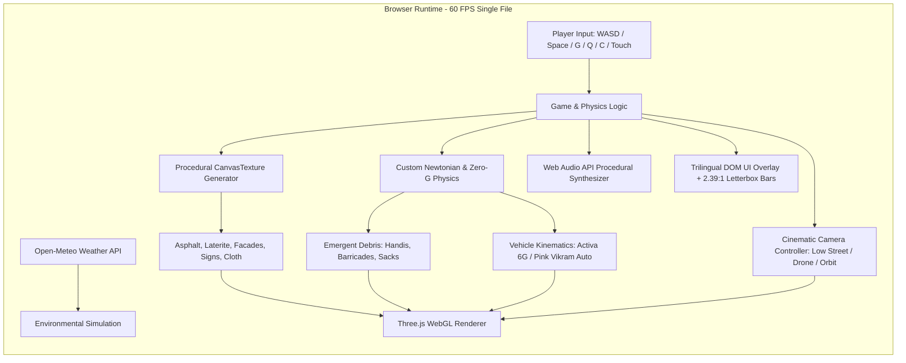

# Product Requirements Document (PRD)
## BHUBANESWAR 3D: AMA GADI, AMA RASTA
### (Benglooru × FightKaro × Delhi Metro × Odia Odyssey Cinematic Cutscenes & Sync Audio Edition)
**A 3D Hyper-Local Open-World Driving, Antigravity Levitation, Procedural Canvas Textures & Cinematic Street Satire Sandbox**

---

## 1. Executive Summary & Product Vision

- **Product Name:** *Bhubaneswar 3D: Ama Gadi, Ama Rasta (Cinematic Textures & Antigravity Edition)*
- **Live Deployment:** [https://forbesayush.github.io/odisha-simulator/](https://forbesayush.github.io/odisha-simulator/)
- **Source Repository:** [github.com/forbesayush/odisha-simulator](https://github.com/forbesayush/odisha-simulator)
- **Target Audience:** Casual web gamers, mobile and desktop commuters, fans of Indian urban culture, retro arcade enthusiasts.
- **Visual Reference:** Inspired by the visual and cultural fidelity of **Odia Odyssey (Amara Odisha Adventures)** (`https://odia-odyssey--8jaliw8a.preview.emergentagent.com/`), **FightKaro.com**, **Benglooru.com**, and **DelhiMetroGame.com**.
- **Core Vision:** Merge the localized urban satire of **Benglooru.com**, the visceral 1v1 arcade combat of **FightKaro.com**, the transit agility of **DelhiMetroGame.com**, and the 3D vehicular open-world freedom of **GTA** with:
  1. **Procedural High-Fidelity Canvas Textures:** Speckled asphalt with oil wear, authentic Odisha laterite stone masonry, detailed multi-story building facades with sunshades, corrugated rolling metal shop shutters, and high-resolution bilingual Odia signboards.
  2. **Anamorphic Cinematic Widescreen Presentation:** 2.39:1 letterbox black bars (`9.5vh`), dynamic multi-angle cinematic tracking cameras (Low-Angle Street Cam, Aerial Drone Cam, 360 Vehicle Orbit Cam), and Odia location title overlays.
  3. **Antigravity Mechanics (ଶୂନ୍ୟ ମାଧ୍ୟାକର୍ଷଣ):** Zero-G flight, glowing neon cyan/magenta plasma repulsor thruster rings beneath wheels, vertical thrust up to 45m altitude, and omnidirectional electromagnetic shockwave pulses.
  4. **Emergent Physics Sandbox:** Movable aluminum Dahibara handis, 50kg potato sacks, yellow police barricades, wooden crates, and levitating sacred cows with multi-body collision momentum transfer.

---

## 2. Core Architectural Pillars

- **Konark GPS Circular Minimap:** 120px circular radar with range rings, rotating player arrow, road networks, and live landmark & traffic pins.
- **Dynamic Day-Night Cycle:** 5 atmospheric lighting presets (Morning Sun, High Noon, Golden Dusk, Cyber Night, Kalabaisakhi Storm) with active vehicle headlights and roadside streetlights.
- **5-Act Story Missions:** Progressive quest system with rewards, level badges, and celebratory victory fanfares.


```
+------------------------------------------------------------------------------------------------------------------+
|                                           BHUBANESWAR 3D CORE PILLARS                                             |
+------------------------------------------------------------------------------------------------------------------+
| 1. CINEMATIC TEXTURES       | 2. ANTIGRAV ZERO-G        | 3. EMERGENT SANDBOX       | 4. BENGLOORU & FIGHTKARO   |
| Procedural asphalt,         | Zero-G flight toggle (G), | 30+ physical rigid bodies | Trilingual street satire,  |
| laterite stone deula,       | vertical thrusters to     | (handis, sacks, barriers, | live Open-Meteo weather,   |
| corrugated shutters, Odia   | 45m, plasma repulsor      | crates) with elastic      | Kalabaisakhi storm toggle, |
| signboards & 2.39:1 bars.   | rings & shockwave pulse.  | collisions & chain react. | and 1v1 FightKaro brawls.  |
+------------------------------------------------------------------------------------------------------------------+
```

---

## 3. High-Level Technical Architecture



---

## 4. Procedural Canvas Texture Specifications

| Texture Key | Resolution | Generation Method | Visual Function |
| :--- | :--- | :--- | :--- |
| **`asphalt`** | $256 \times 256$ | Granular noise speckling + elliptical wear patches | High-realism roadway surface with road tire grip |
| **`ground`** | $256 \times 256$ | Multi-tint speckling (`#432b1f`, `#734c38`, `#586b2f`) | Odisha laterite red-brown earth & roadside vegetation |
| **`pavement`** | $128 \times 128$ | Staggered brick/slab stroke lines + mortar joints | Concrete pedestrian sidewalks along Janpath & NH-16 |
| **`laterite`** | $256 \times 256$ | Staggered masonry blocks with HSL hue variations | Authentic red laterite stone for Kalinga Temple Deula |
| **`facade`** | $128 \times 128$ | Multi-window grid with sunshade lintels & security bars | Urban Bhubaneswar commercial & residential buildings |
| **`shutter`** | $64 \times 64$ | Alternating 4px corrugated horizontal metallic stripes | Street market closed shop rolling security shutters |
| **`signTex`** | $512 \times 128$ | Golden bordered signboard with high-res Odia script | Storefronts: `ଦହିବରା ଆଳୁଦମ୍`, `ଓମ୍ଫେଡ୍ ପାନ ଖଟି`, `ଜଗନ୍ନାଥ ମେଡିକାଲ୍` |
| **`busSide`** | $1024 \times 256$| Green bottom band + red stripe + tinted passenger windows | Official Mo Bus / OSRTC green & cream coach livery |
| **`cloth`** | $128 \times 128$ | Woven check & ikat stripe algorithms | Sambalpuri sarees, lungis, and rider checks |

---

## 5. Cinematic Camera Modes & Letterbox Controls

1. **Anamorphic Widescreen Letterbox Bars (`9.5vh`):**
   - Active when toggled with `[C]` key or the HUD **🎥 CINEMATIC** button.
   - Smooth cubic-bezier slide-in top and bottom black bars framing the action in 2.39:1 aspect ratio.
   - Dynamic location and quote subtitle overlay (`#cine-overlay`).
2. **Cinematic Camera Schemes:**
   - **Mode 1: `LOW_STREET`:** Low-angle tracking shot positioned 1.2m above the tarmac, looking upward at the front wheel, capturing road asphalt grain, wheel spin, and passing roadside palms.
   - **Mode 2: `AERIAL_DRONE`:** Sweeping bird's-eye orbital drone cam hovering 22m high, showing the entire Janpath urban grid, Rasulgarh flyover, and Kalinga temple towers.
   - **Mode 3: `ORBIT_PAN`:** Continuous 360-degree rotation around the player vehicle showcasing the 3D models and street life.
   - **Mode 4: `FIGHT_ARENA`:** Dynamic side-view street brawl framing with physical knockback camera shake.

---

## 6. Antigravity & Emergent Physics Sandbox

### 1. Zero-G Mechanics (`[G]` Key)
- Neutralizes ground gravity and activates glowing cyan/magenta plasma repulsor thruster rings beneath vehicle wheels.
- `Space` to engage upward repulsor thruster lift (hover up to 45m above Janpath).
- `Shift` / `C` to dive down toward roads or rooftop helipads.
- Aerodynamic pitch and roll banking during flight.

### 2. Electromagnetic Repulsor Pulse (`[Q]` / `[B]`)
- Emits an expanding cyan shockwave ring from the vehicle.
- Applies radial outward and vertical lift impulses to all physics bodies in a 36-unit radius.
- Debris (aluminum Dahibara handis, 50kg potato sacks, police barricades, wooden crates) and sacred cows are hurled into weightless zero-G spin, ricocheting off buildings and triggering cascading chain reactions.

---

## 7. Control Mappings (Desktop & Mobile Touch)

| Action | Desktop Key | Mobile Touch Control | Description |
| :--- | :--- | :--- | :--- |
| **Drive / Pitch Down** | `W` / `↑` | **▲ UP** Button | Accelerates forward / tilts nose forward in flight |
| **Brake / Reverse** | `S` / `↓` | **▼ DOWN** Button | Brakes, reverses, or slows flight |
| **Steer Left** | `A` / `←` | **◀ LEFT** Button | Steers left / yaw left in zero-G |
| **Steer Right** | `D` / `→` | **▶ RIGHT** Button | Steers right / yaw right in zero-G |
| **Antigravity Lift** | `Space` | **🚀 LIFT** Button | Fires vertical thrusters to ascend into the sky |
| **Antigravity Descent**| `Shift` | **🛬 DIVE** Button | Descends smoothly toward road or rooftop |
| **Toggle Antigrav** | `G` | **🛸 ZERO-G** Pill | Toggles ground driving $\leftrightarrow$ zero-G flight |
| **Repulsor Shockwave** | `Q` / `B` | **⚡ PULSE** Button | Emits shockwave launching debris into air |
| **Cinematic Mode** | `C` | **🎥 CINEMATIC** Pill| Cycles Low Street, Aerial Drone, and Orbit cams |
| **Exit Cinematic** | `Esc` / `C` | **✕ EXIT** Button | Restores normal third-person follow camera |
| **Vehicle Swap** | `V` | **🔄 SWAP** Pill | Activa 6G $\leftrightarrow$ 1998 Pink Vikram Auto |
| **Sound Horn** | `H` | **📢 HORN** Button | Plays horn; triggers hilarious comedic responses |
| **Interact / Brawl** | `E` / `Enter`| **💥 ACT** Button | Interacts with hotspots or starts 3D fight |
| **Language Switch** | `L` | **🌐 🌐** Button | Cycles Odia (`ଓଡ଼ିଆ`), Hindi (`हिंदी`), English |
| **Intro Cutscene** | `X` | **🎬 INTRO** Pill | Triggers cinematic opening cutscene |
| **Cutscene Advance** | `Space` / `Enter` | **⏭️ NEXT** Button | Advances to next dialogue line |
| **Cutscene Skip** | `Esc` | **⏩ SKIP** Button | Skips current cutscene back to driving |
